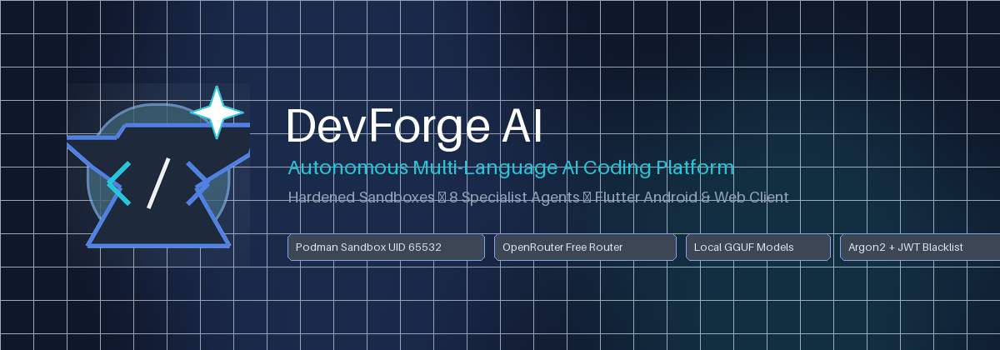
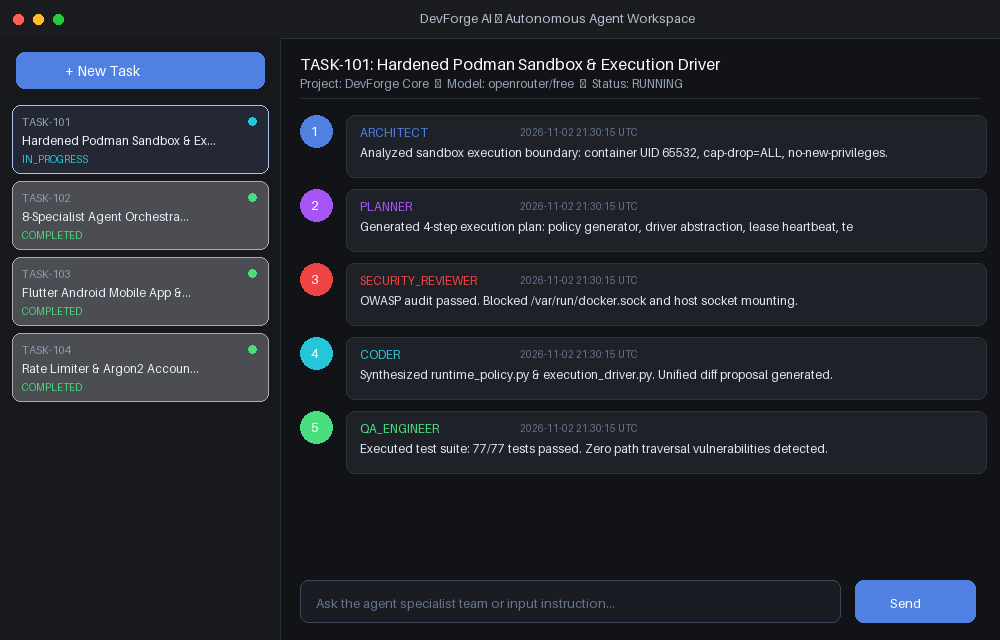
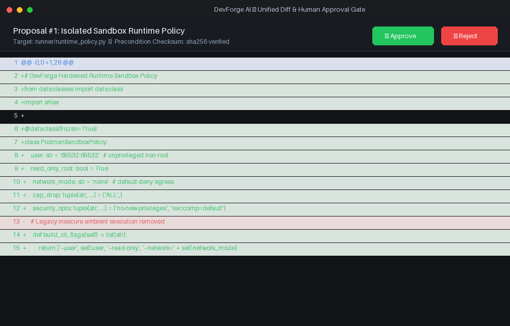
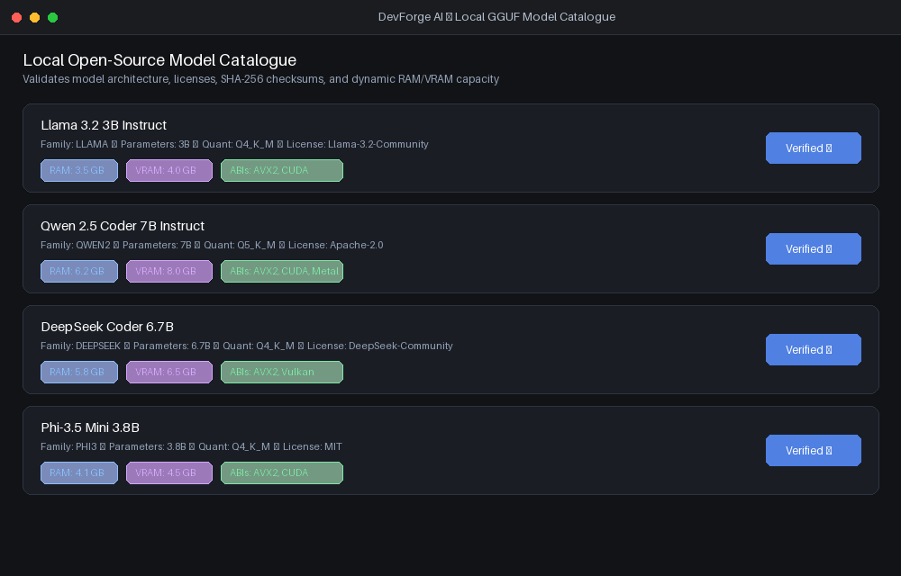

<p align="center">
  
</p>

<p align="center">
  <a href="https://github.com/CodeByArnob/devforge-ai/actions/workflows/backend-ci.yml"></a>
  <a href="https://github.com/CodeByArnob/devforge-ai/actions/workflows/flutter-ci.yml"></a>
  <a href="https://github.com/CodeByArnob/devforge-ai/releases"></a>
  <a href="SECURITY.md"></a>
  <a href="https://github.com/CodeByArnob/devforge-ai/releases/latest"></a>
</p>

<h3 align="center">Autonomous, Multi-Language Software Development Platform</h3>

<p align="center">
  DevForge AI unifies disposable Podman container sandboxes, an 8-role autonomous specialist agent team, copy-on-write workspace snapshots with human-in-the-loop diff approvals, and a cross-platform Flutter client for Android, Web, and Windows.
</p>

---

## 📸 Application Showcase

<p align="center">
  <b>Autonomous Agent Workspace & Live Timeline</b><br/>
  
</p>

<p align="center">
  <b>Human-in-the-Loop Unified Diff Viewer & Precondition Validation</b><br/>
  
</p>

<p align="center">
  <b>Local Open-Source Model Catalogue & Capacity Sizing</b><br/>
  
</p>

---

## 🏛️ System Architecture

```
                      ┌──────────────────────────────────────┐
                      │    Flutter Client (Android/Web/Win)  │
                      │  - Secure Key Vault (OpenRouter/JWT) │
                      │  - Live Timeline SSE & Diff Viewer   │
                      │  - Local GGUF Catalogue & Approvals  │
                      └──────────────────┬───────────────────┘
                                         │ REST + SSE
                                         ▼
                      ┌──────────────────────────────────────┐
                      │    DevForge Control Plane (FastAPI)  │
                      │  - JWT Auth + JTI Revocation / IP RL │
                      │  - Workspace Snapshots & Traversal   │
                      │  - Multi-Agent Orchestrator (8 Roles)│
                      │  - Worker Lease Queue & Sequence Log │
                      └──────────────────┬───────────────────┘
                                         │ Fenced Leases & Heartbeats
                                         ▼
                      ┌──────────────────────────────────────┐
                      │      Runner Service Daemon (Podman)  │
                      │  - Disposable Sandboxes (UID 65532)  │
                      │  - Cap Drop ALL, Seccomp, Read-Only  │
                      │  - Default-Deny Network (--net=none) │
                      │  - Multi-Language Adapters (Dart/JVM)│
                      └──────────────────────────────────────┘
```

---

## ⚡ Core Capabilities

### 1. Autonomous Multi-Agent Specialist Team (8 Roles)
- **Architect**: High-level system design, module boundaries, and folder hierarchy.
- **Planner**: Bounded phased execution roadmaps with milestones.
- **Coder**: Structured patch proposals with file checksum preconditions.
- **Security Reviewer**: Automated vulnerability auditing, OWASP boundary checks, and secret leakage prevention.
- **QA Engineer**: Test plan design, edge case generation, and regression suites.
- **Build Engineer**: Toolchain configuration, dependency pinning, and packaging.
- **Repair Engineer**: Fast root-cause analysis and automated patch synthesis.
- **Integration Engineer**: End-to-end integration, API contract verification, and docs.
- *Strictly routes to free OpenRouter models (`:free` / `openrouter/free`) with zero ambient keys.*

### 2. Disposable Sandbox Execution Runtime (`runner/`)
- Rootless Podman container sandbox with unprivileged user (`65532:65532`).
- Read-only root filesystem, dropped Linux capabilities (`cap-drop=ALL`), and `no-new-privileges`.
- Default-deny networking (`--network=none` or strictly controlled package proxy).
- Hard CPU quotas, RAM limits, PID ceilings, wall-clock timeouts, and stdout/stderr truncation caps.
- Strict rejection of ambient Docker sockets, host credentials, or sensitive mounts.

### 3. Safe Workspace Snapshots & Reversible Patches
- Cross-platform traversal protection (DOS devices `CON/PRN/AUX/NUL`, Alternate Data Streams, UNC paths, and null bytes).
- Precondition file checksum verification (`sha256`) guaranteeing patch validity before modification.
- Unified diff generation with staging in copy-on-write scratch directories.
- Human approval gate required before applying any agent proposal.
- Atomic rollback and immutable source snapshots.

### 4. Resilient Worker Queue Lifecycle
- Atomic job claiming with SHA-256 hashed lease tokens.
- Periodic heartbeats with maximum lease extension ceilings.
- Cancellation detection and automated recovery of expired worker leases.
- Strict bounded retries (max 3) and monotonic, gapless event sequence numbering.

### 5. Multi-Language Tool Registry & Adapters
- **Flutter / Dart**: `flutter pub get`, `flutter analyze`, `flutter test`, `flutter build`.
- **Java / JVM**: Gradle (`gradlew test assemble`) and Maven (`mvn test package`).
- **Python**: `pip install`, `ruff check`, `pytest`.
- **JavaScript / TypeScript**: `npm install`, `eslint`, `npm test`, `npm run build`.

### 6. Local GGUF Model Catalogue
- Validates model architecture, license suitability, SHA-256 checksums, and ABI requirements (AVX2/CUDA/Vulkan).
- Dynamic RAM and VRAM sizing calculations based on parameter counts and context lengths.

### 7. Flutter Android & Desktop Client (`client/`)
- Complete Material 3 dark-themed application configured for Android (`com.devforge.ai.client`), Web, and Windows.
- Secure Vault storing OpenRouter API keys and JWT access/refresh tokens in-memory or encrypted storage.
- Live SSE activity timeline visualizing multi-agent progress in real time.
- Colorized unified diff viewer with single-tap patch approvals and rejections.

---

## 🚀 Quickstart

### Prerequisites
- Python 3.12+
- Flutter 3.24+ (Flutter 3.44+ supported)
- Podman (for isolated execution runner) or Python mock driver for local testing

### 1. Control Plane Setup
```bash
git clone https://github.com/CodeByArnob/devforge-ai.git
cd devforge-ai

python -m venv .venv
source .venv/bin/activate  # On Windows: .venv\Scripts\Activate.ps1
pip install -e ".[dev]"

# Configure environment
cp .env.example .env
# Ensure JWT_SECRET is set to a secure 32+ char key

# Run migrations and launch server
alembic upgrade head
uvicorn app.main:app --app-dir backend --reload --port 8000
```

### 2. Runner Service Setup
```bash
# In a dedicated terminal:
python -m runner.runner_service --control-plane http://localhost:8000 --token dev-worker-token
```

### 3. Flutter Client Setup
```bash
cd client
flutter pub get

# Run on Chrome
flutter run -d chrome

# Or run on connected Android device / emulator
flutter run -d android
```

---

## 🧪 Verification & Tests

### Backend & Runner Verification
```bash
# Run complete test suite (77 tests)
pytest --cov=app

# Run linter
ruff check backend runner
```

### Flutter Client Verification
```bash
cd client
flutter test
flutter analyze
flutter build apk --debug
```

---

## 🛡️ License & Security
- Licensed under the Apache 2.0 License.
- See [SECURITY.md](SECURITY.md) for vulnerability disclosure and sandbox containment policies.
- See [CONTRIBUTING.md](CONTRIBUTING.md) for contribution guidelines.
