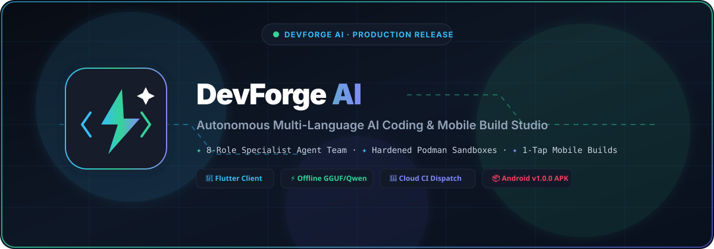
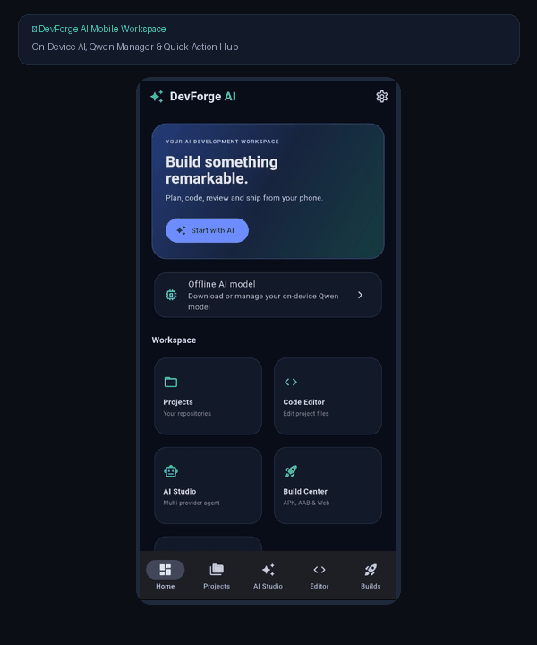
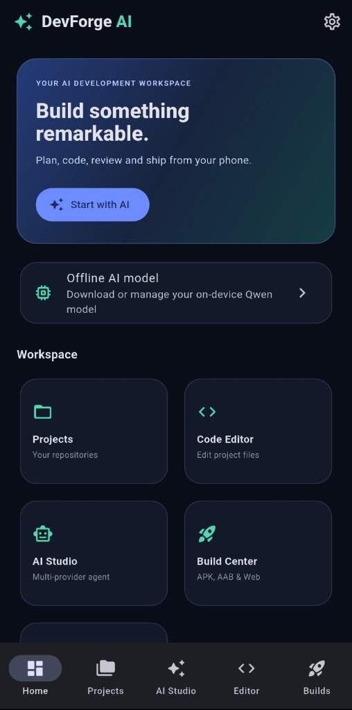
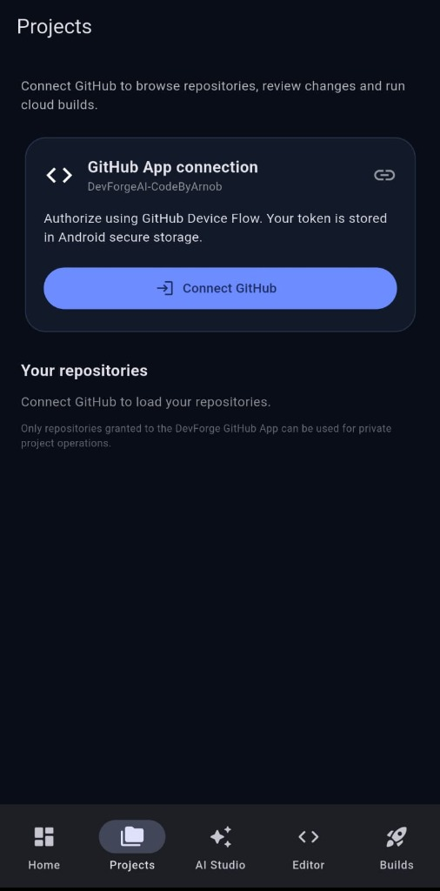
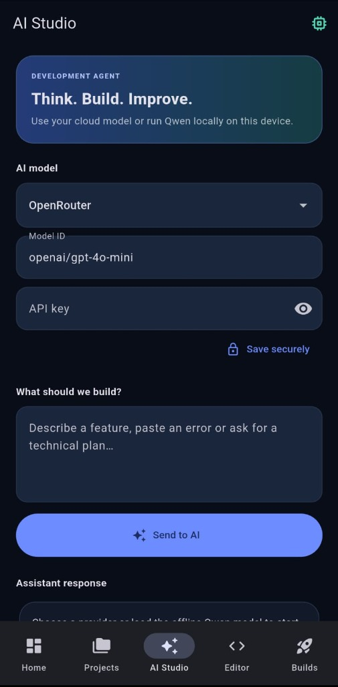
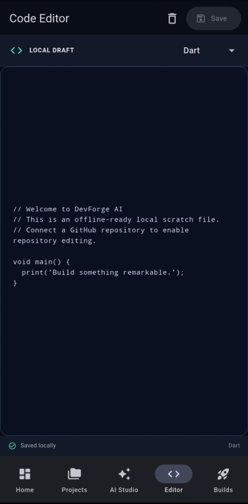
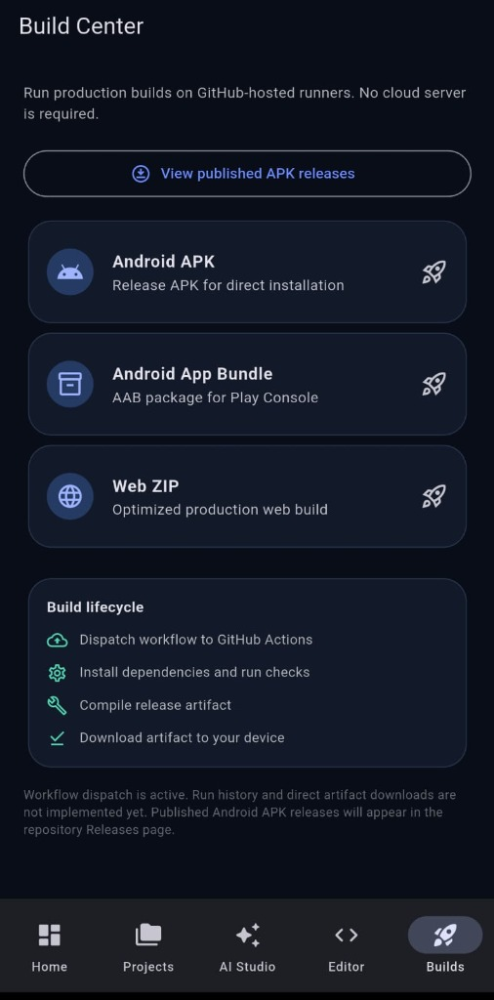

<div align="center">

# DevForge AI

### Autonomous Multi-Language Software Development Platform. One Private Workspace.

An autonomous software engineering platform built with FastAPI, Podman rootless sandboxes, 8 AI specialist agents, and Flutter (Material 3).

<br/>

<p align="center">
  <a href="https://github.com/CodeByArnob/devforge-ai/releases/download/v1.0.0/DevForgeAI-v1.0.0-release.apk">
    
  </a>
  <a href="https://github.com/CodeByArnob/devforge-ai/releases/tag/v1.0.0">
    
  </a>
  <a href="https://codebyarnob.github.io/devforge-ai/">
    
  </a>
</p>

<p align="center">
  
  
  
  
  
  
  <a href="https://github.com/CodeByArnob/devforge-ai/actions/workflows/backend-ci.yml"></a>
  <a href="https://github.com/CodeByArnob/devforge-ai/actions/workflows/flutter-ci.yml"></a>
  
</p>

<br/>



</div>

---

## 🎬 Live Motion Graphics Showcase

<p align="center">
  <b>DevForge AI Mobile IDE — Live End-to-End Workflow</b><br/>
  <sub>Automated agent synthesis, multi-language editing, and one-tap cloud compilation from mobile</sub><br/><br/>
  
</p>

---

## Overview

DevForge AI unifies disposable execution sandboxing, autonomous multi-agent planning, and local-first client controls into one comprehensive workspace. It manages repository ingestion, multi-agent code proposals, diff review, build validation, and terminal execution across Flutter, Java, Python, and JavaScript/TypeScript projects.

The platform is designed around three core principles:

- **Local-first & Isolated**: Untrusted workload execution is strictly confined to disposable rootless Podman sandboxes with UID `65532:65532`, read-only root filesystems, dropped capabilities (`cap-drop=ALL`), and default-deny networking (`--network=none`). Zero host Docker sockets or credentials are ever mounted.
- **Autonomous Specialist Team**: 8 dedicated agents (`architect`, `planner`, `coder`, `security_reviewer`, `qa_engineer`, `build_engineer`, `repair_engineer`, `integration_engineer`) collaborate via structured JSON schemas, request-scoped keys, and strictly enforced free model routing (`:free` / `openrouter/free`).
- **Human-in-the-Loop Verification**: Automated code changes generate unified diffs staged in copy-on-write scratch areas. Precondition `sha256` checksums ensure changes match inspected source trees, and human approval is required before mutating any project files.

---

## Project detail

| Project detail | Value |
| :--- | :--- |
| **Application ID** | `com.devforge.ai.client` |
| **Current release** | **v1.0.0 · versionCode 1** |
| **Minimum Android** | Android 7.0 · API 24 |
| **Target Android** | API 36 (Android 15+) |
| **Control Plane** | FastAPI · Python 3.12+ |
| **Execution Sandbox** | Podman (Rootless, UID 65532, `--network=none`) |
| **Multi-Agent Engine** | 8 Specialist Agents · OpenRouter Free Router |
| **Database & Migrations** | PostgreSQL / SQLite · Alembic Schema v0008 |
| **Client Framework** | Flutter 3.44+ (Material 3 Dark Theme) |
| **Supported Platforms** | Android (APK) · Web (Chrome/Edge) · Windows Desktop |
| **License** | Apache-2.0 |

---

## Download

### DevForge AI v1.0.0
**The latest published Android release**

[Download the APK](https://github.com/CodeByArnob/devforge-ai/releases/download/v1.0.0/DevForgeAI-v1.0.0-release.apk) · [Release page and other assets](https://github.com/CodeByArnob/devforge-ai/releases/tag/v1.0.0)

| File | Target Architecture | Size | Description |
| :--- | :---: | :---: | :--- |
| [`DevForgeAI-v1.0.0-arm64-v8a.apk`](https://github.com/CodeByArnob/devforge-ai/releases/download/v1.0.0/DevForgeAI-v1.0.0-arm64-v8a.apk) | **arm64-v8a** | **17.0 MB** | **Recommended: Modern Android Devices** |
| [`DevForgeAI-v1.0.0-release.apk`](https://github.com/CodeByArnob/devforge-ai/releases/download/v1.0.0/DevForgeAI-v1.0.0-release.apk) | Universal / arm64 | 17.0 MB | Fast 1-click installer |
| [`DevForgeAI-v1.0.0-armeabi-v7a.apk`](https://github.com/CodeByArnob/devforge-ai/releases/download/v1.0.0/DevForgeAI-v1.0.0-armeabi-v7a.apk) | armeabi-v7a | 14.5 MB | 32-bit legacy devices |
| [`DevForgeAI-v1.0.0-x86_64.apk`](https://github.com/CodeByArnob/devforge-ai/releases/download/v1.0.0/DevForgeAI-v1.0.0-x86_64.apk) | x86_64 | 18.4 MB | Chromebooks & PC Emulators |
| [`SHA256SUMS.txt`](https://github.com/CodeByArnob/devforge-ai/releases/download/v1.0.0/SHA256SUMS.txt) | All | — | Cryptographic SHA-256 Checksums |
| [`SIGNING-CERTIFICATE.txt`](https://github.com/CodeByArnob/devforge-ai/releases/download/v1.0.0/SIGNING-CERTIFICATE.txt) | All | — | Persistent Upload Key Fingerprints |

> [!IMPORTANT]
> **Signing and installation compatibility**: The current v1.0.0 APK was built and verified with the persistent release key whose SHA-256 certificate fingerprint is:
> `94:BB:DD:18:24:54:01:13:7B:4D:AD:89:20:48:20:43:85:EB:B3:DE:81:EC:D2:45:24:C3:B4:22:AC:17:30:88`

---

## Application Showcase

<table align="center" width="100%">
  <tr>
    <td align="center" width="50%" valign="top">
      <b>Home Workspace & Action Hub</b><br/>
      <sub>On-Device Workspace, Quick-Action Grid & Offline Qwen Manager</sub><br/><br/>
      
    </td>
    <td align="center" width="50%" valign="top">
      <b>Projects & GitHub App Connection</b><br/>
      <sub>Device Flow Authorization & Repository Inventory</sub><br/><br/>
      
    </td>
  </tr>
  <tr>
    <td align="center" width="50%" valign="top">
      <b>AI Studio & Multi-Agent Planning</b><br/>
      <sub>Multi-Provider Agent, Prompt Synthesis & Unified Diff Approvals</sub><br/><br/>
      
    </td>
    <td align="center" width="50%" valign="top">
      <b>Offline-Ready Code Editor</b><br/>
      <sub>Multi-Language Scratchpad, Local Persistence & Clean Developer UI</sub><br/><br/>
      
    </td>
  </tr>
  <tr>
    <td align="center" colspan="2" valign="top">
      <b>Build Center & CI/CD Cloud Dispatch</b><br/>
      <sub>GitHub Actions Dispatch, Production APK / AAB / Web Artifacts</sub><br/><br/>
      
    </td>
  </tr>
</table>

---

## Architecture & Multi-Agent Collaboration

```
                      ┌──────────────────────────────────────┐
                      │    Flutter Client (Android/Web/Win)  │
                      │  - Secure Key Vault (OpenRouter/JWT) │
                      │  - Live Timeline SSE & Diff Viewer   │
                      │  - Local GGUF Catalogue & Approvals  │
                      └──────────────────┬───────────────────┘
                                         │ REST + SSE
                                         ▼
                      ┌──────────────────────────────────────┐
                      │    DevForge Control Plane (FastAPI)  │
                      │  - JWT Auth + JTI Revocation / IP RL │
                      │  - Workspace Snapshots & Traversal   │
                      │  - Multi-Agent Orchestrator (8 Roles)│
                      │  - Worker Lease Queue & Sequence Log │
                      └──────────────────┬───────────────────┘
                                         │ Fenced Leases & Heartbeats
                                         ▼
                      ┌──────────────────────────────────────┐
                      │      Runner Service Daemon (Podman)  │
                      │  - Disposable Sandboxes (UID 65532)  │
                      │  - Cap Drop ALL, Seccomp, Read-Only  │
                      │  - Default-Deny Network (--net=none) │
                      │  - Multi-Language Adapters (Dart/JVM)│
                      └──────────────────────────────────────┘
```

### Specialist Agent Matrix

| Agent Role | Primary Focus | Output Schema / Permissions |
| :--- | :--- | :--- |
| **Architect** | System design, directory tree, boundary analysis | Architectural blueprint & module contracts |
| **Planner** | Phased milestone decomposition | Ordered action steps & checkpoints |
| **Coder** | Concrete code generation | Precondition-checksum structured patches |
| **Security Reviewer** | SAST, secret leakage, OWASP boundaries | Vulnerability risk audit & mitigation gates |
| **QA Engineer** | Test harness design, edge cases, assertions | Test execution plans & regression coverage |
| **Build Engineer** | Dependency lockfiles, toolchain configs | Build, compile, and package commands |
| **Repair Engineer** | Root-cause analysis & automated fix loop | Targeted bugfix unified diff proposals |
| **Integration Engineer** | Contract compliance, E2E validation | Final release readiness report & documentation |

---

## Contributing

We welcome community contributions, feature proposals, and bug reports! Follow these guidelines to contribute professionally:

1. **Fork & Branch**:
   ```bash
   git checkout -b feat/your-feature-name
   ```
2. **Setup Local Environment**:
   ```bash
   python -m venv .venv
   source .venv/bin/activate  # Windows: .venv\Scripts\Activate.ps1
   pip install -e ".[dev]"
   alembic upgrade head
   ```
3. **Verify Tests**:
   - Backend: `pytest` (77 tests)
   - Linter: `ruff check backend runner`
   - Client: `cd client && flutter test && flutter analyze`
4. **Submit PR**: Open a pull request against `main`. All GitHub Actions CI checks must pass green before merge.

See [CONTRIBUTING.md](CONTRIBUTING.md) for complete guidelines.

---

## License

DevForge AI is distributed under the [Apache-2.0 License](LICENSE).

**DevForge AI · Built for clarity, control and local-first personal software engineering.**

[Download](https://github.com/CodeByArnob/devforge-ai/releases/download/v1.0.0/DevForgeAI-v1.0.0-release.apk) · [Website](https://codebyarnob.github.io/devforge-ai/) · [Report an issue](https://github.com/CodeByArnob/devforge-ai/issues)
